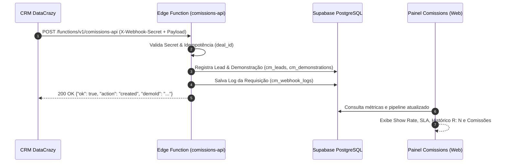

# Documentação Técnica: Automações & Integração Webhook CRM DataCrazy

Esta documentação detalha a arquitetura, endpoints, catálogo de eventos, dicionário de dados, cálculo de indicadores comerciais (Show Rate e Ciclo SLA) e monitoramento de logs do módulo de automações da plataforma **Comissions**.

---

## 1. Visão Geral da Arquitetura

O módulo de automações substitui controles manuais e planilhas externas por uma conexão direta entre o **CRM DataCrazy** e a plataforma **Comissions**.

Quando uma oportunidade avança no funil comercial do CRM (ex: agendamento, remarcação, comparecimento ou fechamento), um webhook dispara um evento HTTP `POST` para a API do Comissions, que:
1. Valida a assinatura de segurança (`X-Webhook-Secret`).
2. Garante **idempotência** por meio do `deal_id` (evitando duplicações em reenvios de rede).
3. Vincula automaticamente a empresa (`company_id`), o SDR (`sdr_email`) e o Closer (`closer_email`).
4. Calcula métricas de desempenho em tempo real (**Show Rate**, **Média de Remarcações** e **Ciclo Médio / SLA em dias**).
5. Transfere automaticamente as vendas ganhas para a apuração de comissões comerciais (`cm_sales_commissions`).
6. Registra cada requisição no histórico de auditoria (`cm_webhook_logs`) para inspeção na interface.



---

## 2. Endpoints e Autenticação

### Informações de Conexão

| Parâmetro | Valor de Produção |
| :--- | :--- |
| **URL do Endpoint** | `https://dojpymvpdmuxbcxllwne.supabase.co/functions/v1/comissions-api` |
| **Método HTTP** | `POST` |
| **Formato** | `application/json` (UTF-8) |
| **Header de Segurança** | `X-Webhook-Secret: quantis_crm_secret_2026` |

> [!IMPORTANT]
> O cabeçalho `X-Webhook-Secret` é obrigatório para autenticar as requisições enviadas por servidores externos (como o CRM). Requisições sem esse cabeçalho ou com valor divergente receberão status HTTP `401 Unauthorized`.

---

## 3. Dicionário de Dados e Mapeamento

### A. Identificador da Empresa (`company_id`)
Representa a empresa proprietária do lead e da oportunidade. O valor enviado deve corresponder exatamente ao identificador cadastrado na plataforma:

| Nome da Empresa | Identificador (`company_id`) |
| :--- | :--- |
| **Quantis Lift** | `quantis` |
| **Frotlog** | `frotlog` |
| **Locadora Beta / LB** | `lb` |

### B. Vínculo Automático de Responsáveis (SDR & Closer)
O Comissions localiza automaticamente os perfis em `cm_profiles` pelo endereço de e-mail informado:
- **`sdr_email`**: E-mail do profissional de pré-vendas responsável pelo agendamento.
- **`closer_email`**: E-mail do executivo de vendas responsável por conduzir a apresentação.

Se o e-mail não existir na base, a demonstração é criada normalmente e o gestor pode atribuir o responsável manualmente na tela operacional.

### C. Idempotência (`deal_id`)
- O campo `deal_id` (ID da oportunidade no DataCrazy) é a chave primária de rastreio externo.
- Se o CRM disparar o evento `demo_scheduled` mais de uma vez para a mesma oportunidade, o sistema reconhece a existência e retorna status `200 OK` com a mensagem `"Demonstração já cadastrada (idempotente)"`, evitando duplicidade de dados e distorção nas metas.

---

## 4. Catálogo Completo de Eventos

### Evento 1: `demo_scheduled` (Novo Agendamento)
Disparado quando a reunião de demonstração é agendada no CRM.

* **Efeitos no Sistema:**
  - Cria o lead em `cm_leads` caso ainda não exista.
  - Cria a demonstração com status `agendado`.
  - Salva a data em `first_scheduled_date` (data original imutável) e em `current_scheduled_date`.
  - Inicia o contador de remarcações com `reschedule_count = 0`.
  - Define `is_completed = false`.

#### Payload de Envio (CRM &rarr; Comissions):
```json
{
  "event": "demo_scheduled",
  "company_id": "quantis",
  "data": {
    "deal_id": "deal-8491",
    "company_name": "Aliança Locações de Máquinas",
    "contact_name": "Carlos Eduardo",
    "phone": "11987654321",
    "email": "carlos@alianca.com.br",
    "segment": "Locação de Máquinas",
    "sdr_email": "sdr@quantisgrowth.com",
    "closer_email": "closer@quantisgrowth.com",
    "scheduled_at": "2026-11-10T14:30:00Z",
    "mrr": 697.00,
    "setup": 790.00
  }
}
```

#### Resposta da API (HTTP 200 OK):
```json
{
  "ok": true,
  "action": "created",
  "demoId": "550e8400-e29b-41d4-a716-446655440000"
}
```

---

### Evento 2: `demo_rescheduled` (Remarcação de Demonstração)
Disparado quando o cliente solicita adiar a reunião ou um novo horário é agendado.

* **Efeitos no Sistema:**
  - Registra uma linha em `cm_reschedule_logs` com a data anterior (`previous_date`), a nova data (`new_date`) e a justificativa (`reason`).
  - Incrementa o contador incremental (`reschedule_count = reschedule_count + 1`).
  - Atualiza `current_scheduled_date` com a nova data.
  - Altera o status para `agendado` e redefine `is_completed = false`.

#### Payload de Envio:
```json
{
  "event": "demo_rescheduled",
  "company_id": "quantis",
  "data": {
    "deal_id": "deal-8491",
    "new_date": "2026-11-14T16:00:00Z",
    "reason": "Cliente solicitou alteração por conta de viagem da diretoria"
  }
}
```

#### Resposta da API (HTTP 200 OK):
```json
{
  "ok": true,
  "action": "rescheduled",
  "demoId": "550e8400-e29b-41d4-a716-446655440000"
}
```

---

### Evento 3: `demo_no_show` (Não Comparecimento / Falta)
Disparado quando o cliente não entra na reunião agendada.

* **Efeitos no Sistema:**
  - Define `is_completed = false`.
  - Altera o status da demonstração para `aguardando_reagendamento`.
  - Destaca o card no pipeline operacional para atuação da equipe de SDR.

#### Payload de Envio:
```json
{
  "event": "demo_no_show",
  "data": {
    "deal_id": "deal-8491"
  }
}
```

#### Resposta da API (HTTP 200 OK):
```json
{
  "ok": true,
  "action": "no_show",
  "demoId": "550e8400-e29b-41d4-a716-446655440000"
}
```

---

### Evento 4: `demo_completed` (Demonstração Realizada)
Disparado após o Closer conduzir a reunião de demonstração.

* **Efeitos no Sistema:**
  - Marca `is_completed = true` (impactando positivamente o Show Rate).
  - Altera o status para `realizado`.
  - Preenche `completed_date` com a data/hora do término da reunião.
  - **Calcula automaticamente o ciclo da oportunidade (SLA):**
    $$\text{cycle\_days} = \text{differenceInDays}(\text{completed\_date}, \text{first\_scheduled\_date})$$

#### Payload de Envio:
```json
{
  "event": "demo_completed",
  "data": {
    "deal_id": "deal-8491",
    "completed_at": "2026-11-10T15:30:00Z"
  }
}
```

#### Resposta da API (HTTP 200 OK):
```json
{
  "ok": true,
  "action": "completed",
  "demoId": "550e8400-e29b-41d4-a716-446655440000"
}
```

---

### Evento 5: `deal_won` (Venda Fechada / Ganho Comercial)
Disparado quando a proposta comercial é aceita e o contrato é firmado.

* **Efeitos no Sistema:**
  - Altera o status da oportunidade para `fechado`.
  - Marca `is_completed = true`.
  - Registra a entrada na tabela financeira de comissões (`cm_sales_commissions`).
  - Discrimina os valores negociados de **MRR** e **Setup**.
  - Rateia a comissão devida ao **SDR** e ao **Closer**.
  - Define o status inicial do pagamento como `pendente`.

#### Payload de Envio:
```json
{
  "event": "deal_won",
  "data": {
    "deal_id": "deal-8491",
    "mrr": 697.00,
    "setup": 790.00,
    "sdr_commission_amount": 50.00,
    "closer_commission_amount": 209.10
  }
}
```

#### Resposta da API (HTTP 200 OK):
```json
{
  "ok": true,
  "action": "won",
  "demoId": "550e8400-e29b-41d4-a716-446655440000"
}
```

---

### Evento 6: `deal_lost` (Perda / Descarte)
Disparado se a negociação for encerrada sem venda.

* **Efeitos no Sistema:**
  - Altera o status da oportunidade para `perdido`.
  - Grava a justificativa em `loss_reason` para auditoria e análise de motivos de perda.

#### Payload de Envio:
```json
{
  "event": "deal_lost",
  "data": {
    "deal_id": "deal-8491",
    "reason": "Sem orçamento disponível neste trimestre"
  }
}
```

#### Resposta da API (HTTP 200 OK):
```json
{
  "ok": true,
  "action": "lost",
  "demoId": "550e8400-e29b-41d4-a716-446655440000"
}
```

---

## 5. Indicadores Comerciais Calculados Automaticamente

O Comissions processa as métricas operacionais sem necessidade de fórmulas manuais:

| Indicador | Regra / Fórmula | Finalidade |
| :--- | :--- | :--- |
| **Show Rate (%)** | `(Total com is_completed = true / Total agendamentos) * 100` | Avalia a qualidade do agendamento do SDR e o comparecimento dos leads. |
| **Média de Remarcações** | `Soma de reschedule_count / Total de oportunidades` | Identifica gargalos de pontualidade e atritos na agenda. |
| **Ciclo Médio de Demo (SLA)** | `Média de cycle_days nas demos realizadas` | Mede o tempo decorrido em dias entre a data original marcada e a realização. |
| **Pipeline Projetado** | `Soma de MRR + Setup (status agendado, follow-up e trial)` | Projeta o volume financeiro ativo na esteira comercial. |
| **Comissões do Mês** | `Soma de sdr_commission + closer_commission em vendas fechadas` | Previsão e controle dos repasses à equipe de vendas. |

---

## 6. Ferramentas Integradas na Plataforma

### A. Página de Automações (`#Automações`)
Acessível a administradores e gestores diretamente pelo menu lateral da plataforma:
1. **Credenciais Visíveis:** URL e token de segurança prontos para copiar.
2. **Dicionário em Tela:** Lista de slugs de empresas e e-mails de vendedores para conferência imediata.
3. **Simulador de Disparos:** Permite disparar qualquer evento de teste diretamente da tela sem precisar acionar o CRM.
4. **Log de Execuções (`cm_webhook_logs`):** Tabela que registra data, hora, evento, status HTTP e botão para **inspecionar o JSON completo** recebido do CRM.

### B. Módulo de Demonstrações (`#Demonstrações`)
1. **Badge `R: N` Interativo:** Toda linha com remarcações exibe uma tag (ex: `R: 2`). Ao clicar, um modal abre a linha do tempo cronológica com quem remarcou, quando e o motivo.
2. **Toggle de Comparecimento Rápido:** O vendedor ou gestor pode alternar o status de realização da demo com um clique (`✓ Realizada / ✗ Não realizada`).
3. **Aba de Comissões CRM:** Tabela discriminando MRR, Setup, comissão do SDR e comissão do Closer, com botões para aprovação e confirmação de pagamento (`Aprovar` &rarr; `Marcar Pago`).

---

## 7. Guia de Configuração no CRM DataCrazy

Para configurar os disparos no DataCrazy:

1. Acesse o menu **Configurações &rarr; Automações &rarr; Webhooks** no CRM.
2. Crie uma nova automação para cada fase do funil desejada:
   - **Gatilho:** *"Oportunidade moveu para a etapa Demonstração Agendada"* &rarr; Disparar evento `demo_scheduled`.
   - **Gatilho:** *"Data da reunião alterada"* &rarr; Disparar evento `demo_rescheduled`.
   - **Gatilho:** *"Oportunidade marcada como Não Compareceu"* &rarr; Disparar evento `demo_no_show`.
   - **Gatilho:** *"Reunião finalizada / Apresentação realizada"* &rarr; Disparar evento `demo_completed`.
   - **Gatilho:** *"Oportunidade Ganha"* &rarr; Disparar evento `deal_won`.
   - **Gatilho:** *"Oportunidade Perdida"* &rarr; Disparar evento `deal_lost`.
3. Preencha a URL de destino:
   `https://dojpymvpdmuxbcxllwne.supabase.co/functions/v1/comissions-api`
4. Adicione o cabeçalho HTTP:
   `X-Webhook-Secret: quantis_crm_secret_2026`
5. Configure o corpo da requisição (JSON) mapeando as variáveis dinâmicas do lead e da oportunidade.
6. Realize um disparo de teste e confira o recebimento imediato na aba **Automações** do Comissions!

